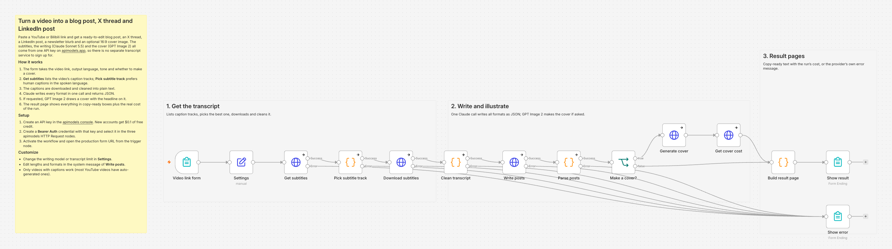
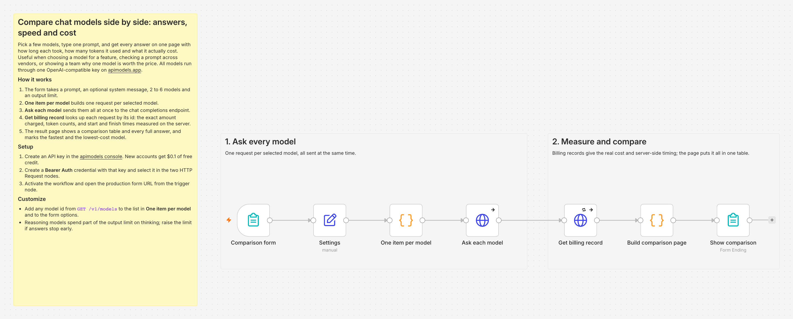
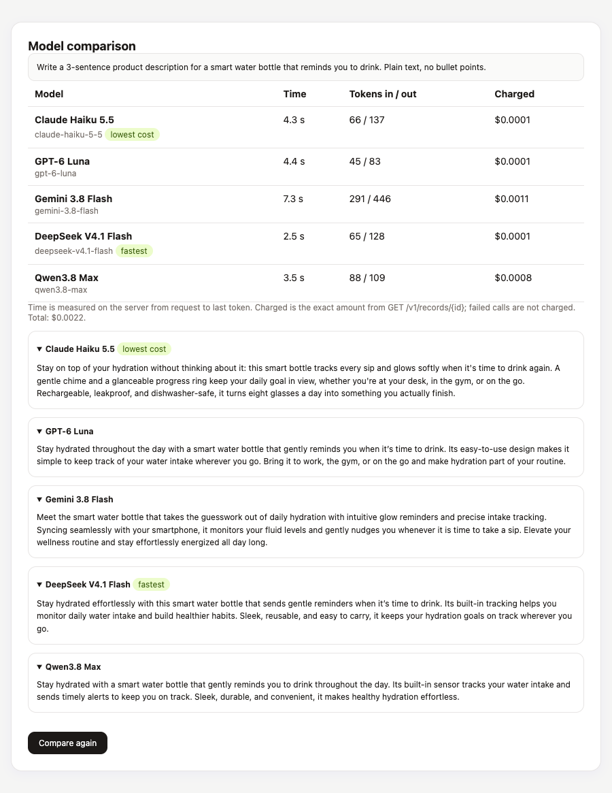
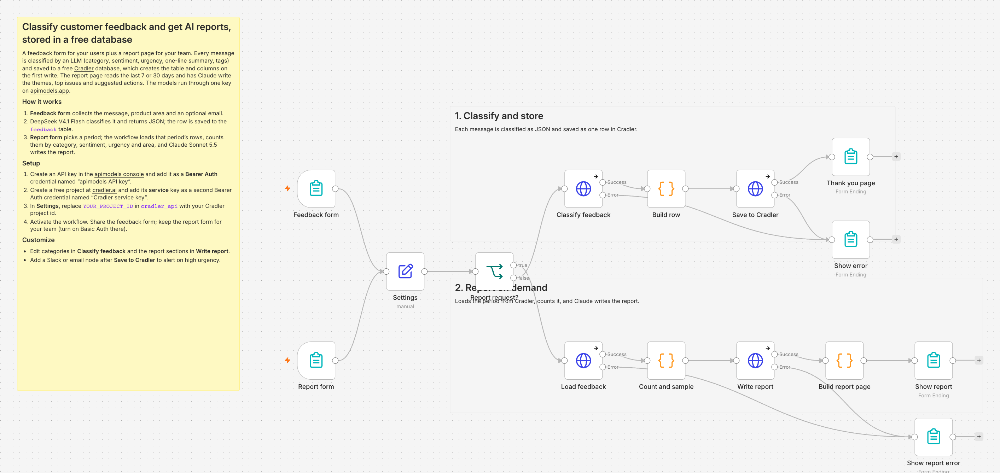
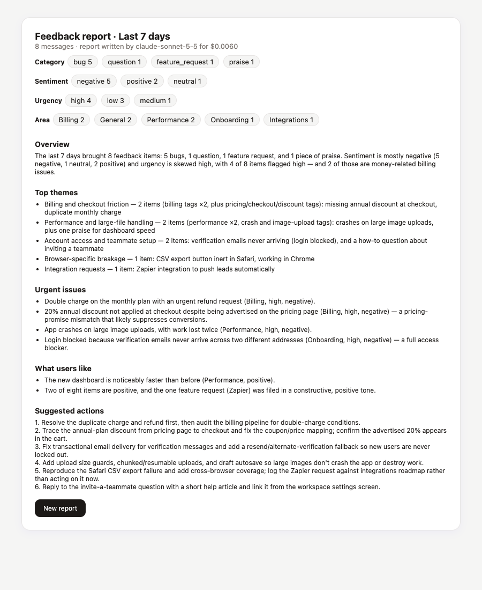
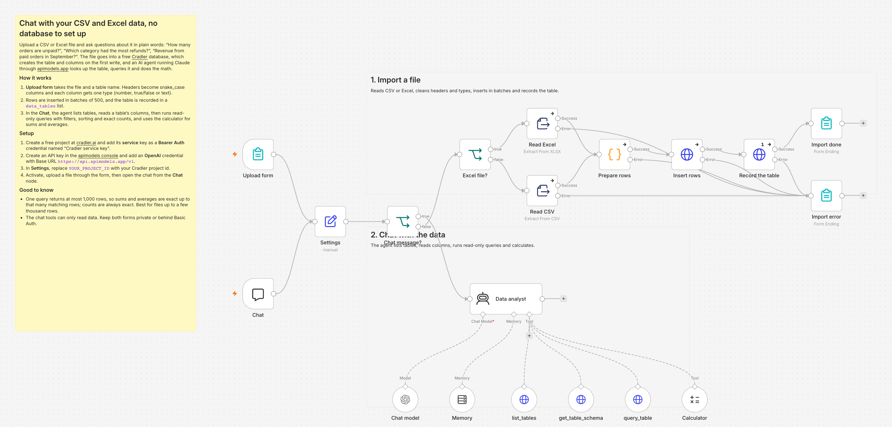
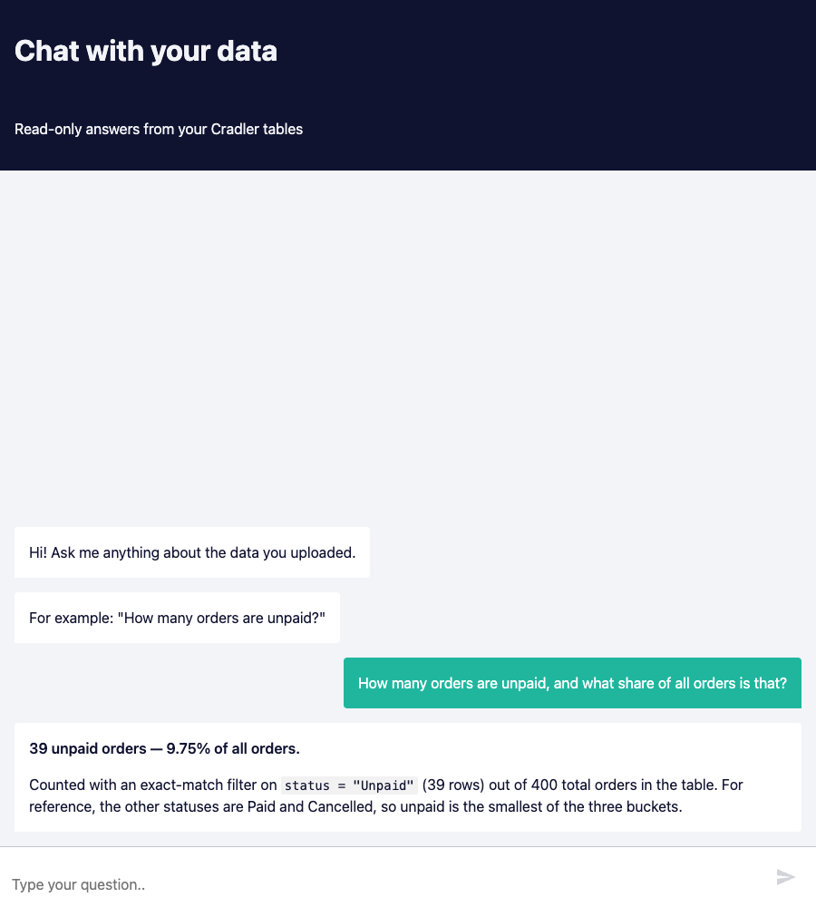

# n8n templates for apimodels.app

Ready-to-import [n8n](https://n8n.io) workflows that generate images, video, speech and text with one API key from [apimodels.app](https://apimodels.app), an OpenAI-compatible API for 150+ image, video, audio and language models. Each workflow uses only core n8n nodes (no community nodes), includes sticky-note instructions, and was run end to end before publishing.

Maintained by the apimodels.app team. The two data templates store their data in [Cradler](https://cradler.ai), a free-to-start database and file storage service built by the same team.

| Template | What it does | Models | Typical run |
|---|---|---|---|
| [Product photo to ad image](templates/product-photo-to-ad-image-gpt-image-2.md) | n8n form: upload a product photo, pick a scene, get an ad-ready image with the product unchanged | GPT Image 2 | 1K about 30 s, 2K about 2 min |
| [Photo to short video](templates/photo-to-short-video-seedance-2.md) | n8n form: prompt plus optional first-frame photo to a 5–15 s video with sound | Seedance 2.0 Mini / Fast / standard | 5 s Mini 480p about 2–3 min |
| [Blog post to podcast](templates/blog-post-to-podcast-claude-elevenlabs.md) | n8n form: article URL or text to a narrated MP3 episode | Claude Sonnet 5.5 + ElevenLabs v4 | 1-minute episode about 40 s |
| [Chat agent with image tool](templates/chat-agent-with-image-generation.md) | Hosted chat: an AI agent that answers and draws on request | Claude Haiku 5.5 + GPT Image 2 | Image reply about 1–2 min |
| [Video to blog post, X thread and LinkedIn post](templates/video-to-blog-thread-linkedin-claude.md) | n8n form: YouTube or Bilibili link to a blog post, X thread, LinkedIn post, newsletter blurb and cover, written from the subtitles | Claude Sonnet 5.5 + GPT Image 2 | 19-min video about 2.5 min, $0.063 |
| [Compare chat models side by side](templates/compare-chat-models-side-by-side.md) | n8n form: one prompt to 2–6 models, with server-measured time, tokens and exact cost per model | Claude, GPT, Gemini, DeepSeek, Qwen, Grok, GLM | 5 models about 15 s, under $0.01 |
| [Customer feedback triage and reports](templates/feedback-triage-cradler-deepseek.md) | Feedback form classified by an LLM and stored in a free Cradler database, plus an on-demand AI report page | DeepSeek V4.1 Flash + Claude Sonnet 5.5 + Cradler | $0.0001 per message, report about 25 s / $0.006 |
| [Chat with your CSV and Excel data](templates/chat-with-csv-excel-data-cradler.md) | Upload a file into a free Cradler database, then ask questions in n8n's hosted chat; read-only agent with exact counts | Claude Sonnet 5.5 + Cradler | 400-row file imported in 9 s; answers in 20–95 s |

Timings and costs come from our own test runs on n8n 2.43.8 on 2026-10-19. Prices are on each model's page at apimodels.app; failed generations are not charged.

## Import a template

1. Download a `.json` file from [`templates/`](templates).
2. In n8n, open a new workflow, click the `...` menu and choose **Import from File** (or paste the JSON onto the canvas).
3. Add your credential (below), select it in the nodes marked with a credential warning, and activate the workflow.

## Credentials

Create an API key in the [apimodels console](https://apimodels.app/console/api-keys). New accounts get $0.1 of free credit.

- **Form templates** (image, video, podcast, video-to-posts, model comparison) use a **Bearer Auth** credential: paste the key as the token.
- **Data templates** also need a **Bearer Auth** credential named "Cradler service key" with the service key of a free Cradler project, and your project id in Settings.
- **Chat agent** and **Chat with your data** use an **OpenAI** credential: paste the key and set **Base URL** to `https://api.apimodels.app/v1`. The same credential works in any OpenAI Chat Model or AI Agent node, so you can run Claude, GPT, Gemini, DeepSeek or Qwen in n8n by changing the model id.

## Screenshots

**Product photo to ad image**: workflow, form and result page

 

**Photo to short video**

**Blog post to podcast**

**Video to blog post, X thread and LinkedIn post**

**Compare chat models side by side**

**Customer feedback triage and reports**

**Chat with your CSV and Excel data**

**Chat agent with image tool**

## How the media workflows handle async jobs

Image and video models run as tasks. The form templates create a task, then loop through **Wait → Check task status → Route by status** until the task is `completed` or `failed`, with a limit in **Settings**. The result page reads the charge from the task itself (`data.credits`), and `GET /v1/records/{task_id}` returns the same amount later for bookkeeping. For a single request that returns the image directly, as the chat agent's tool does, send an OpenAI-style `size` without `callback_url` to `POST /v1/images/generations`.

More: [API docs](https://apimodels.app/docs) · [n8n guide](https://apimodels.app/docs/n8n) · [All models](https://apimodels.app/models)

## License

MIT
